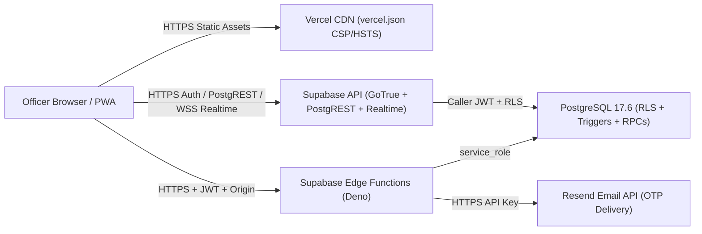
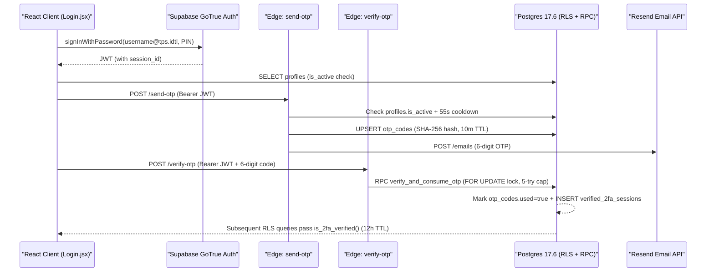

# System Architecture — TPS

This document describes the verified runtime, frontend, backend, caching, and infrastructure architecture of TPS as implemented in the codebase.

---

## 1. High-Level Architecture

TPS uses a **client-heavy Single-Page Application (SPA)** deployed on **Vercel** that communicates directly with **Supabase** (PostgREST + Realtime + GoTrue Auth) for standard scoped CRUD/analytics, and delegates privileged or secret-requiring workflows to **3 Deno Edge Functions**.

---

## 2. Project Directory Organization (85 Tracked/Source Files)

- **Root (`16` files)**: Build/hosting configs (`vite.config.mjs`, `vercel.json`, `tailwind.config.js`, `postcss.config.js`, `index.html`, `package.json`), security rule (`AGENTS.md`), documentation (`*.md`), local env (`.env.local` — ignored by Git).
- **`public/icons/` (`2` files)**: PWA manifest icons (`icon-192.png`, `icon-512.png`).
- **`src/` (`38` files)**:
  - `main.jsx`, `App.jsx`, `index.css` — Bootstrap, lazy routes, 2FA/session guard, global design tokens.
  - `components/` (`15` feature components + `3` layout components in `layout/`) — Route views, modals, sidebar navigation, swipe container, scroll wrapper, skeletons, empty states.
  - `lib/` (`13` modules) — Supabase client, client PII storage, IndexedDB cache, offline retry queue, notifications, role/scope helpers, query/export sanitizers, Excel parser, print window & templates.
  - `assets/` (`4` files) — `IDTL_logo.png`, `taang_flag.jpg`, `theme-bg.svg`, `fonts/Pyidaungsu.ttf`.
- **`supabase/` (`29` files)**:
  - `functions/` (`3`) — `create-user/index.ts`, `send-otp/index.ts`, `verify-otp/index.ts`.
  - `migrations/` (`17`) — Chronological schema, RPC, RLS, trigger, and cleanup migrations (`20260518` – `20260603`).
  - `.temp/` (`9`) — Supabase CLI project link & engine metadata.

---

## 3. Frontend Architecture

### 3.1 Bootstrap & Auth Session Gate (`src/main.jsx` -> `src/App.jsx`)
1. `src/main.jsx` initializes `drainQueue()` if `navigator.onLine && queueLength() > 0`, registers a `window` `'online'` auto-sync listener, and mounts `<BrowserRouter><App /></BrowserRouter>`.
2. `src/App.jsx` restores the Supabase session (`supabase.auth.getSession()`), calls `supabase.rpc('is_2fa_verified')` to enforce server-verified Email OTP 2FA, fetches the officer's `profiles` row (`is_active`, `role`, `access_level`, `allowed_districts`, `allowed_townships`), and signs out immediately if either check fails.
3. Unauthenticated users see `<IntroAnimation />` + `/login` (`Login.jsx`). Authenticated users receive:
   - Lazy-loaded routes via `React.lazy()` + `<Suspense fallback={<PageFallback />}>`
   - 30-minute inactivity auto-logout (`mousemove`, `keydown`, `click`, `scroll`, `touchstart`)
   - 2-minute `profiles.last_seen_at` heartbeat
   - Supabase Realtime `postgres_changes` listener on own `profiles` row (live role/scope sync and instant logout if `is_active` becomes `false`).

### 3.2 Layout & Navigation (`Layout.jsx`, `Sidebar.jsx`, `TpsScrollWrapper.jsx`)
- **Desktop (`>= 768px`)**: Sticky `240px` left sidebar filtering navigation items by `user.role` and `user.access_level`, showing active notification count (`tps:notifications` custom event), persona badge (`getProfileType`), and `Sign Out`.
- **Mobile (`< 768px`)**: Fixed `mobile-topbar`, fixed `60px` bottom navigation (`4` primary tabs + `"More"` slide-up sheet), and horizontal page-swipe navigation (`PAGE_ORDER` in `Layout.jsx`).
- **Tables**: `<TpsScrollWrapper>` wraps wide civil registry tables using `MutationObserver` + horizontal scroll skip buttons.

### 3.3 Client Storage, Caching & PWA Strategy
| Mechanism | File | Key / Store | TTL / Lifetime | Security Controls |
|---|---|---|---|---|
| **Session PII Storage** | `src/lib/secureStorage.js` | `sessionStorage` (`tps_household_form_draft`, `tps_retry_queue`, `tps_backup_history_logs`) | Current browser tab/session | Per-session CSPRNG 256-bit key (`tps_session_cipher_key`), clears stale `localStorage` PII copies |
| **Auth Lockout Storage** | `src/lib/secureStorage.js` | `localStorage` (`tps_login_attempts`, `tps_login_lockout_until`) | Until login success / timeout | Obfuscated `tps_enc_v2:` + in-memory `useRef` mirror in `Login.jsx` |
| **IndexedDB Read Cache** | `src/lib/offlineCache.js` | `tps_offline_cache` (`cache` store, used by `Reports.jsx`) | **15 minutes** | User-scoped key prefix (`reports_v6_${user.id}_...`), cleared on `handleLogin` and `handleLogout` |
| **Stats Session Cache** | `PopulationStatistics.jsx`, `DemographicDashboard.jsx` | `sessionStorage` (`tps_stats_cache_v3_*`, `tps_demo_cache_v1_*`) | **5 minutes** | User-scoped key prefix, wiped via `sessionStorage.clear()` on logout |
| **Notification Log** | `src/lib/notifications.js` | `localStorage` (`tps_notifications`, max 50) | Persistent until cleared | Filtered to `ERROR` and `WARNING` only (`OFFLINE` & non-urgent types suppressed) |
| **Workbox Service Worker** | `vite.config.mjs` | Precache app shell + `google-fonts-cache` | Static build / 1yr fonts | Supabase API/REST/Storage traffic is **explicitly excluded** from SW caching |

---

## 4. Backend & Edge Function Architecture (`supabase/functions/`)

Edge Functions run on Deno (`std@0.168.0`), initialize an admin Supabase client (`SUPABASE_SERVICE_ROLE_KEY`), enforce `Origin` checks against `ALLOWED_ORIGIN` (with Vercel preview regex matching when a `.vercel.app` origin is configured), and verify caller JWTs via `supabaseAdmin.auth.getUser(token)`.

---

## 5. Printing, Excel & Parsing Architecture

- **Excel/CSV/JSON Import (`CsvUploader.jsx`, `excelParser.js`)**:
  - `.xlsx` parsed client-side by **ExcelJS**.
  - `.xls` (legacy binary) parsed on demand via lazy-loaded `import('xlsx')` with a `50,000`-row cap (`MAX_LEGACY_XLS_ROWS`) and prototype-key header filtering (`FORBIDDEN_HEADER_KEYS`).
  - `.csv` streamed in UTF-8 via **PapaParse**.
  - Imported values strip formula-injection prefixes via `unsanitizeImportedCell()` (`exportSanitize.js`).
- **Excel Export (`householdPrint.js`, `statisticsPrint.js`)**: Generated in-browser with **ExcelJS**; every text cell passes through `sanitizeSpreadsheetCell()` (`exportSanitize.js`) to neutralize `=`, `+`, `-`, `@`, `\t`, `\r` formula prefixes.
- **PDF Print Preview (`printWindowHelper.js`)**: Opens a blank popup (`w.opener = null`), writes self-contained HTML escaped with `safeHtml()`, and binds print/close click listeners from the parent script so zero inline `<script>` or `onclick` handlers are needed under strict CSP (`script-src 'self'`).
