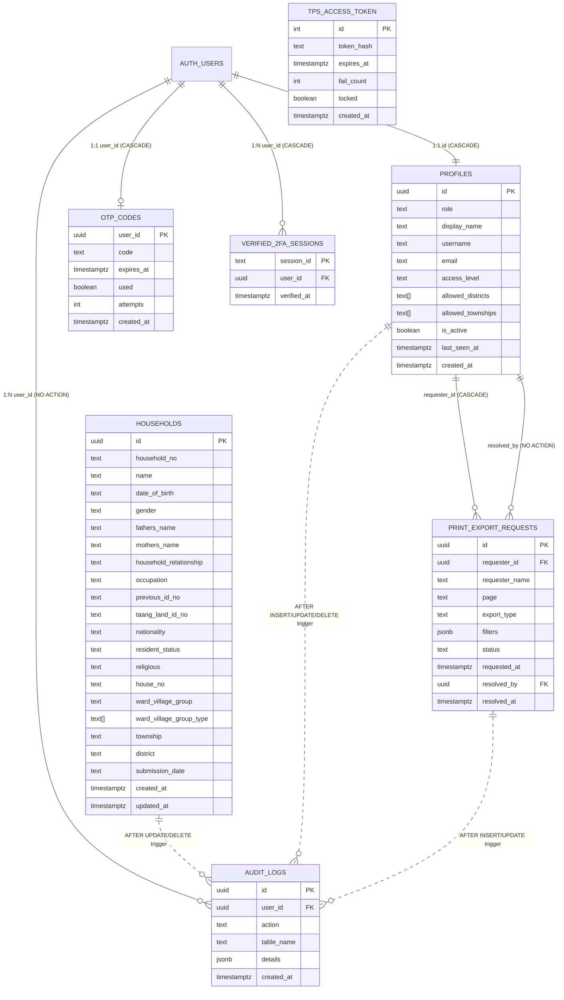

# Database Schema — TPS (PostgreSQL 17.6 / Supabase)

Documented directly from all **17** migration files in [supabase/migrations/](file:///c:/Users/User/Desktop/Our%202026%20Code%20PJ/TPS/supabase/migrations/) (`20260518` through `20260603`), Edge Functions, and frontend queries.

> [!NOTE]
> **Pre-Migration Schema Boundary**: `public.households`, `public.profiles`, the base `audit_logs` structure before `20260601`, and 6 live-only helper/report RPCs (`report_wards`, `report_groups_by_township`, `report_village_only`, `report_groups`, `normalize_myanmar_text`, `update_updated_at_column`) existed in the live Supabase database prior to `20260518_population_stats_rpcs.sql`. Columns marked *(Pre-existing)* below are verified from `ALTER TABLE` statements, RPC queries, triggers, and frontend queries; exact live `CREATE TABLE` defaults/constraints for pre-`20260518` columns were not independently queried from production.

---

## 1. Entity Relationship Diagram

---

## 2. Table Reference

### 2.1 `public.households` *(Pre-existing base table)*
- **Purpose**: Core civil registry storing one row per household member.
- **Columns**:
  - `id` (UUID PK), `household_no` (TEXT), `name` (TEXT), `date_of_birth` (TEXT — Myanmar/ASCII `DD.MM.YYYY`), `gender` (TEXT — `'ကျား'`, `'က'`, `'မ'`), `fathers_name`, `mothers_name`, `household_relationship`, `occupation`, `previous_id_no` (NRC), `taang_land_id_no`, `nationality`, `resident_status`, `religious`, `house_no`, `ward_village_group` (TEXT), `ward_village_group_type` (`TEXT[]`), `township` (TEXT), `district` (TEXT), `submission_date` (TEXT), `created_at` (`TIMESTAMPTZ`), `updated_at` (`TIMESTAMPTZ`).
- **Indexes (`20260518:394-397`)**:
  - `idx_households_district (district)`
  - `idx_households_township (township)`
  - `idx_households_district_township (district, township)`
  - `idx_households_household_no (household_no)`
- **RLS**: `ENABLE ROW LEVEL SECURITY` (`20260530:310`)
  - `households_select_scoped` (`SELECT`): `can_access_household(district, township)`
  - `households_insert_scoped` (`INSERT`), `households_update_scoped` (`UPDATE`), `households_delete_scoped` (`DELETE`): `can_write_household(district, township)`
- **Grants**: `authenticated` -> `SELECT, INSERT, UPDATE, DELETE`; `anon`/`PUBLIC` revoked.

### 2.2 `public.profiles` *(Pre-existing + `20260523`, `20260528`)*
- **Purpose**: Officer identity, RBAC role, activation state, heartbeat, and geographic access boundaries.
- **Columns**:
  - *(Pre-existing)* `id` (`UUID PRIMARY KEY REFERENCES auth.users(id) ON DELETE CASCADE`), `role` (`TEXT`), `display_name` (`TEXT`), `created_at` (`TIMESTAMPTZ`).
  - *(Added by migrations)* `is_active` (`BOOLEAN NOT NULL DEFAULT TRUE`), `last_seen_at` (`TIMESTAMPTZ DEFAULT NULL`), `username` (`TEXT`), `email` (`TEXT`), `access_level` (`TEXT NOT NULL DEFAULT 'central'`), `allowed_districts` (`TEXT[] NOT NULL DEFAULT '{}'`), `allowed_townships` (`TEXT[] NOT NULL DEFAULT '{}'`).
- **RLS**: `ENABLE ROW LEVEL SECURITY` (`20260530:197`)
  - `profiles_select_own_or_admin` (`SELECT`): `auth.uid() = id OR is_active_system_admin()`
  - `profiles_update_own_safe` (`UPDATE`, `20260531:138-155`): requires `auth.uid() = id`, `is_2fa_verified()`, `is_active IS NOT FALSE`, and `self_profile_unchanged(...)` (prevents editing `role`, `access_level`, `is_active`, `allowed_districts`, `allowed_townships`, `username`, `email`).
  - `profiles_admin_update_all` (`UPDATE`): `is_active_system_admin()`.
- **Grants**: `authenticated` -> `SELECT, UPDATE`; `service_role` -> `ALL`.

### 2.3 `public.otp_codes` (`20260528_otp_codes_table.sql`)
- **Columns**: `user_id` (`UUID PRIMARY KEY REFERENCES auth.users(id) ON DELETE CASCADE`), `code` (`TEXT NOT NULL` — SHA-256 hex digest), `expires_at` (`TIMESTAMPTZ NOT NULL`), `used` (`BOOLEAN NOT NULL DEFAULT FALSE`), `attempts` (`INT NOT NULL DEFAULT 0`), `created_at` (`TIMESTAMPTZ NOT NULL DEFAULT NOW()`).
- **RLS & Grants**: `otp_codes_deny_all` (`ALL` -> `false` for `anon, authenticated`); `PUBLIC, anon, authenticated` stripped in `20260603:127-130`. `service_role` only.

### 2.4 `public.verified_2fa_sessions` (`20260529_verified_2fa_sessions.sql`)
- **Columns**: `session_id` (`TEXT PRIMARY KEY`), `user_id` (`UUID NOT NULL REFERENCES auth.users(id) ON DELETE CASCADE`), `verified_at` (`TIMESTAMPTZ NOT NULL DEFAULT now()`).
- **Index**: `idx_verified_2fa_sessions_user_id (user_id)`.
- **RLS & Grants**: `verified_2fa_sessions_deny_all` (`false`); `service_role` only. Checked by `SECURITY DEFINER` `is_2fa_verified()` (`20260603:11-28`, 12-hour TTL).

### 2.5 `public.print_export_requests` (`20260528_print_export_requests.sql`)
- **Columns**: `id` (`UUID PRIMARY KEY DEFAULT gen_random_uuid()`), `requester_id` (`UUID REFERENCES profiles(id) ON DELETE CASCADE`), `requester_name` (`TEXT NOT NULL DEFAULT ''`), `page` (`TEXT NOT NULL`), `export_type` (`TEXT NOT NULL`), `filters` (`JSONB NOT NULL DEFAULT '{}'`), `status` (`TEXT NOT NULL DEFAULT 'pending'`), `requested_at` (`TIMESTAMPTZ NOT NULL DEFAULT NOW()`), `resolved_by` (`UUID REFERENCES profiles(id)` — defaults to `NO ACTION`), `resolved_at` (`TIMESTAMPTZ`).
- **RLS (`20260530`, `20260531`)**:
  - `per_insert_own_pending` (`INSERT`): requires `is_2fa_verified()`, `requester_id = auth.uid()`, `status = 'pending'`, `resolved_by IS NULL`, `resolved_at IS NULL`, `page IN ('statistics','demographics')`, `export_type IN ('print','excel')`, active profile, and `access_level <> 'sub_township'`.
  - `per_select_own_or_admin` (`SELECT`): `is_2fa_verified() AND (requester_id = auth.uid() OR is_active_admin_or_regional())`.
  - `per_update_admin_resolve` (`UPDATE`): `is_active_admin_or_regional()`.
  - `per_update_requester_mark_used` (`UPDATE`): requester transitions `status` from `'resolved'` -> `'used'`.
- **Grants**: `authenticated` -> `SELECT, INSERT, UPDATE`.

### 2.6 `public.audit_logs` (`20260530`, altered `20260601`)
- **Columns**: `id` (`UUID PRIMARY KEY DEFAULT gen_random_uuid()`), `user_id` (`UUID REFERENCES auth.users(id)` — defaults to `NO ACTION`), `action` (`TEXT NOT NULL`), `table_name` (`TEXT` added safely in `20260601`), `details` (`JSONB`), `created_at` (`TIMESTAMPTZ DEFAULT now()`).
- **RLS (`20260530`, `20260603:146-155`)**: Append-only; `audit_logs_select_admin` (`is_active_system_admin()`), `audit_logs_insert_own` (`is_2fa_verified() AND user_id = auth.uid() AND action NOT LIKE 'DB\_%' ESCAPE '\'`). No `UPDATE` or `DELETE` grants for client roles.

### 2.7 `public.tps_access_token` (`20260522_tps_access_token.sql` — Legacy Unused)
- **Extension**: `pgcrypto`.
- **Columns**: `id` (`INT PRIMARY KEY DEFAULT 1 CHECK (id = 1)`), `token_hash` (`TEXT NOT NULL`), `expires_at` (`TIMESTAMPTZ NOT NULL`), `fail_count` (`INT NOT NULL DEFAULT 0`), `locked` (`BOOLEAN NOT NULL DEFAULT FALSE`), `created_at` (`TIMESTAMPTZ NOT NULL DEFAULT now()`).
- **RLS & Grants**: Default-deny; all client grants revoked (`20260603:126-129`). No frontend UI uses this table.

---

## 3. Triggers

| Trigger | Table | Event | Function | Audit / Purpose |
|---|---|---|---|---|
| `trg_audit_households_mutation` | `public.households` | `AFTER UPDATE OR DELETE` | `log_household_mutation()` (`20260530:391-441`) | Records `DB_UPDATE_MEMBER` / `DB_DELETE_MEMBER` with `auth.uid()`, `record_id`, `household_no`, `name`, old/new `district`/`township` |
| `trg_audit_profiles_mutation` | `public.profiles` | `AFTER INSERT OR UPDATE OR DELETE` | `log_profile_mutation()` (`20260603:158-242`) | Records `DB_PROFILE_INSERT` / `DB_PROFILE_UPDATE` / `DB_PROFILE_DELETE` (skips pure 2-min `last_seen_at` heartbeat updates) |
| `trg_audit_print_export_mutation` | `public.print_export_requests` | `AFTER INSERT OR UPDATE` | `log_print_export_mutation()` (`20260603:244-297`) | Records `DB_EXPORT_REQUEST_CREATE` / `DB_EXPORT_REQUEST_UPDATE` on status transitions |
| *(Live-only trigger)* | *(Pre-existing)* | — | `update_updated_at_column()` (`20260602:92`) | `search_path` pinned to `'public'` in Phase 1 cleanup |

---

## 4. Storage Bucket & Policies (`storage.objects`, `20260602:10-58`)
- Bucket: `id-scans` (guarded by `IF to_regclass('storage.objects') IS NOT NULL`)
  - `active_users_read_id_scans` (`SELECT`): `is_2fa_verified()` + active profile.
  - `active_users_upload_id_scans` (`INSERT`): `is_2fa_verified()` + active + non-viewer/sub_township + valid role.
  - `active_users_delete_id_scans` (`DELETE`): `is_active_admin_or_regional()`.
  - *(No `src/` code currently calls `supabase.storage` for `id-scans`.)*

---

## 5. SQL Functions & Known Migration Ordering Issue

- **Active RPCs**: `stats_districts`, `stats_townships`, `stats_locations`, `stats_breakdown`, `report_districts`, `report_townships`, `report_wards`*(live-only)*, `report_groups_by_township`*(live-only)*, `report_village_only`*(live-only)*, `is_2fa_verified`, `revoke_current_2fa_session`, `verify_and_consume_otp` (`service_role` only).
- **Security Helpers (`SET search_path = 'public'`, `PUBLIC`/`anon` revoked)**: `is_active_system_admin`, `is_active_admin_or_regional`, `self_profile_unchanged`, `can_access_household`, `can_write_household`, `parse_myanmar_date`, `classify_wvg`, `split_wvg`, `age_bucket`.
- **Dropped in `20260602`**: `check_is_admin(uuid)`, `get_user_role(uuid)`, `is_admin()`, `is_ops_or_higher()`.
- **Unused Legacy Functions Still in DB**: `report_villages(text)`, `verify_access_token(text)`, `set_access_token(text)`, `get_access_token_status()`, `get_my_role()`, `is_user_active()`, `report_groups(text)`*(live-only)*, `normalize_myanmar_text(text)`*(live-only)*.
- **Critical Migration Ordering Conflict (`20260522`)**:
  - `20260522_stats_age_pyramid.sql` defines `age_bucket_6(text)` and adds 12 age-pyramid fields (`ag0_4m`..`ag60pf`) + `withId` + `occCounts` to `stats_breakdown`.
  - `20260522_stats_occupation_gender_id.sql` sorts alphabetically **after** `_age_pyramid` and executes `CREATE OR REPLACE FUNCTION public.stats_breakdown(...)` **without** `age_bucket_6` or `ag*` pyramid fields. Replaying migrations alphabetically from scratch overwrites the pyramid fields expected by `DemographicDashboard.jsx` and `statisticsPrint.js`.
